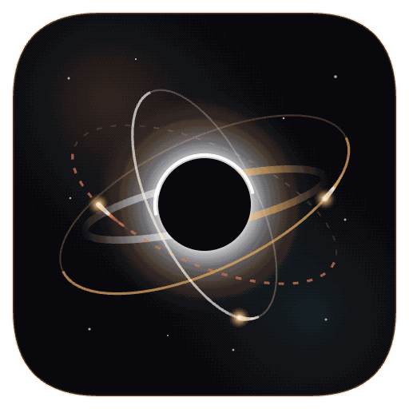
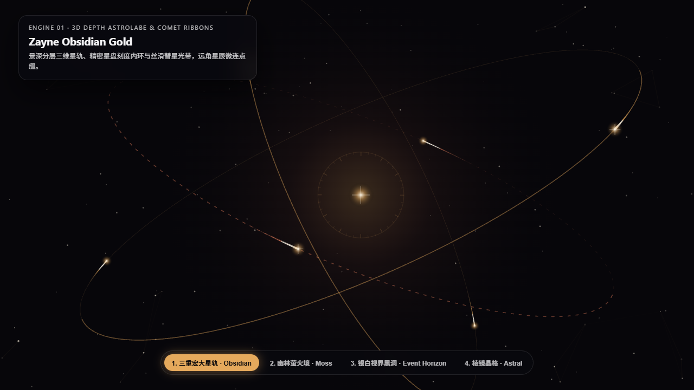
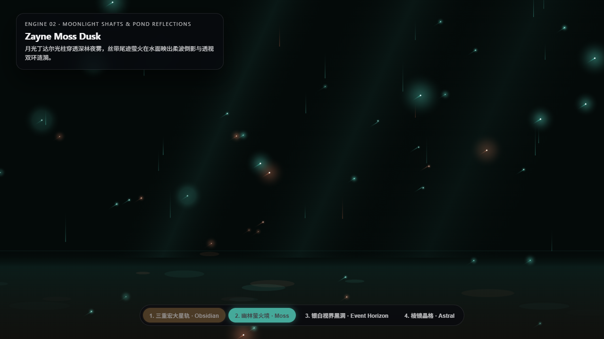
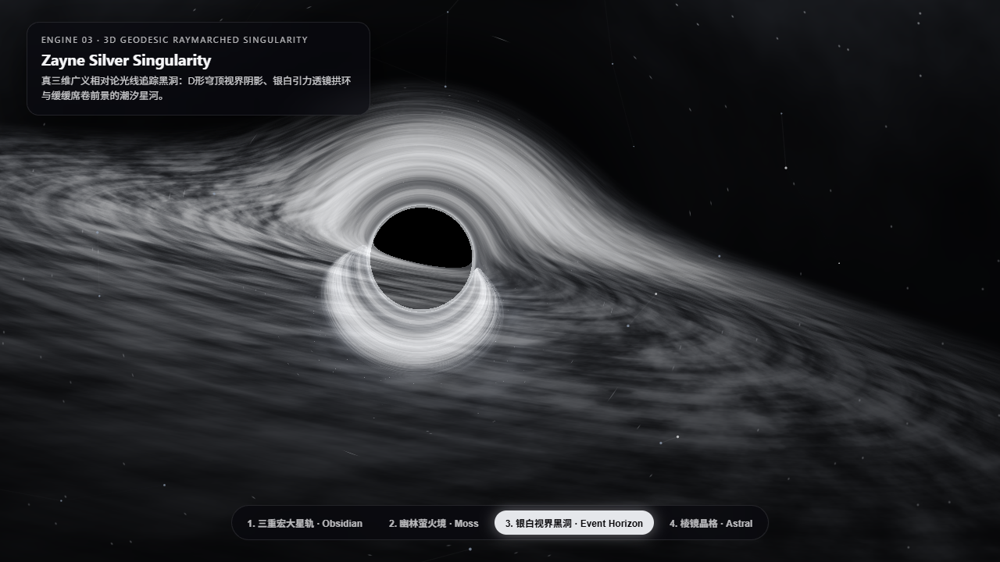
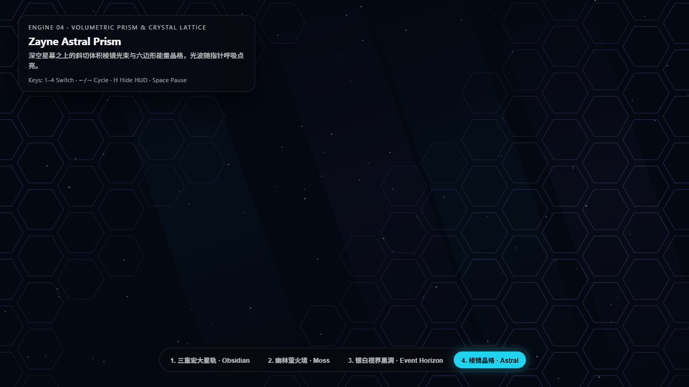

<p align="center">
  
</p>

<h1 align="center">ZayneTheme</h1>

<p align="center">
  Five cohesive dark cosmic themes paired with interactive WebGL &amp; Canvas 2D Living Cosmos engines for <strong>Paseo</strong>.<br/>
  为 <strong>Paseo</strong> 打造的五款深空主题与交互式 WebGL / Canvas 动态宇宙背景插件。
</p>

---

## Previews / 实机视觉预览

<table>
  <tr>
    <td width="50%" align="center">
      <br/>
      <strong>1. Zayne Obsidian Gold</strong><br/>
      <sub>3D Depth Astrolabe Orbits &amp; Tapered Comet Ribbons</sub>
    </td>
    <td width="50%" align="center">
      <br/>
      <strong>2. Zayne Moss Dusk</strong><br/>
      <sub>Feathered Moonlight Shafts, Silk-Trail Fireflies &amp; Pond Ripples</sub>
    </td>
  </tr>
  <tr>
    <td width="50%" align="center">
      <br/>
      <strong>3. Zayne Silver Singularity</strong><br/>
      <sub>3D General-Relativistic Geodesic Raymarched Black Hole (WebGL)</sub>
    </td>
    <td width="50%" align="center">
      <br/>
      <strong>4. Zayne Astral Prism</strong><br/>
      <sub>Volumetric Prism Beams &amp; Reactive Hexagonal Lattice</sub>
    </td>
  </tr>
</table>

---

## Theme Palette Matrix / 主题配色矩阵

| Theme | ID | Background | Raised | Accent | Ring | Engine |
| :--- | :--- | :---: | :---: | :---: | :---: | :--- |
| **Zayne Cyber Aurora** | `zaynetheme` | `#06060f` | `#0e0d16` | `#d97757` | `#38bdf8` | Cyber Aurora Wave |
| **Zayne Obsidian Gold** | `zaynetheme-obsidian-gold` | `#07060a` | `#110f15` | `#e5a95c` | `#d97757` | 3D Astrolabe Orbits |
| **Zayne Moss Dusk** | `zaynetheme-moss-dusk` | `#040a09` | `#0b1614` | `#5eead4` | `#d97757` | Moonlight &amp; Fireflies |
| **Zayne Silver Singularity** | `zaynetheme-silver-singularity` | `#050508` | `#0d0e13` | `#e5e7eb` | `#cbd5e1` | WebGL 3D Black Hole |
| **Zayne Astral Prism** | `zaynetheme-astral-prism` | `#040811` | `#0a1322` | `#22d3ee` | `#a78bfa` | Volumetric Prism Lattice |

---

## Key Features / 核心特性

- **5 Curated Dark Palettes** registered via Paseo's native `client.addTheme` API (`Settings → Appearance`).
- **In-App Living Cosmos Runtime (`client/cosmos-engine.ts`)**: automatically detects the active Zayne theme on Paseo Desktop & Web and softly `screen`-composites the matching animated scene behind the UI.
- **Zero-Overhead Idle & Non-Destructive Coexistence**: pauses the `requestAnimationFrame` loop completely when `document.hidden`, when the optional **Respect reduced motion** setting is toggled on while OS reduced-motion is enabled, or when Scene Mode is set to `Off` / non-Zayne themes. Leaves native `#paseo-cyber-aurora-canvas` untouched in `Auto` mode on Cyber Aurora.
- **Native Paseo Settings & Command Center**:
  - Open **Settings → Plugins → ZayneTheme Cosmos** to customize Scene Mode (`auto`, `orbital`, `moss`, `blackhole`, `prism`, `aurora`, `off`), Ambient Intensity (`subtle`, `balanced`, `immersive`), Pointer Ripples, and Reduced Motion.
  - Use Command Center actions: **ZayneTheme: Cycle Living Cosmos Scene** and **ZayneTheme: Configure Living Cosmos**.
- **Standalone Interactive Preview Lab**: open [`live-cosmos-lab.html`](live-cosmos-lab.html) in any modern browser to audition the engines (`1`–`4` or `←`/`→` switch scenes, `H` hides HUD, `Space` pauses).

---

## DIY & Cross-Harness Porting / 自主 DIY 与跨 Harness 复刻指南

**Open Source (MIT License)** — Feel free to fork this repository, customize palettes or shader physics, and **port this Living Cosmos aesthetic to any other Agent / Harness UI** (such as OpenCode, Claude Code Web/Desktop wrappers, Hermes Web UI, custom Electron apps, or personal dashboards).

### How to replicate into another Agent / Harness (3-Step Blueprint)

1. **Extract the Color Tokens** ([`client/themes.ts`](client/themes.ts)): Copy the 5 dark palettes (`background`, `raised`, `control`, `border`, `accent`, `ring`) and map them to your target app's CSS custom properties or theme registry.
2. **Reuse the Zero-Dependency Visual Engines** ([`client/cosmos-engine.ts`](client/cosmos-engine.ts) & [`live-cosmos-lab.html`](live-cosmos-lab.html)): All 5 scenes (Gargantua WebGL geodesic black hole, 3D astrolabe orbits, moonlight moss fireflies, volumetric astral prism lattice, cyber aurora) use pure browser WebGL + Canvas 2D with no framework lock-in. Mount a full-viewport overlay (`position: fixed; inset: 0; pointer-events: none; mix-blend-mode: screen;`) in any Web/Electron shell and wire your target harness's theme-change event to `detectActiveTheme()`.
3. **Preview & Tune Standalone**: Open [`live-cosmos-lab.html`](live-cosmos-lab.html) directly in Chrome/Edge to iterate on colors, star density, and GLSL shaders at 60 FPS before porting into your own harness.

| File | Purpose / 作用 | What to customize / 可改内容 |
| :--- | :--- | :--- |
| [`client/themes.ts`](client/themes.ts) | Theme palettes & theme-to-engine mapping | Edit `#hex` colors (`background`, `raised`, `control`, `border`, `accent`, `ring`) or map themes to engines |
| [`client/cosmos-engine.ts`](client/cosmos-engine.ts) | 5 WebGL & Canvas 2D backdrop engines | Tune `INTENSITY_OPACITY`, GLSL black hole colors/spin in `BLACKHOLE_FS`, star count, or particle physics |
| [`client/preferences.ts`](client/preferences.ts) | Persistent client preferences (`localStorage`) | Change defaults (`mode`, `intensity`, `interactive`, `respectReducedMotion`) |
| [`client/settings-page.tsx`](client/settings-page.tsx) | Paseo native **Settings → Plugins** screen | Add sliders, presets, or extra controls |
| [`live-cosmos-lab.html`](live-cosmos-lab.html) | Zero-dependency standalone preview lab | Open directly in Chrome/Edge to tune shaders/particles at 60 FPS before copying into your own harness |

---

## Installation / 安装方式

Once submitted and approved in the Paseo Plugin Registry (`plugins.paseo.sh`, requires **Paseo >= 0.17.4**):

```bash
paseo plugin add yy3350008-lgtm/zaynetheme
```

Or install directly from GitHub right now:

```bash
paseo plugin add git:yy3350008-lgtm/zaynetheme
```

Or install from a local directory checkout:

```bash
paseo plugin add /path/to/zaynetheme
```

---

## Platform Support / 平台支持

| Platform | Theme Color Palettes | Living Cosmos WebGL/Canvas |
| :--- | :---: | :---: |
| **Paseo Desktop (Windows / macOS / Linux)** | ✅ | ✅ |
| **Paseo Web** | ✅ | ✅ |
| **Paseo iOS / Android** | ✅ | Static palette fallback |

---

## Development & Verification / 本地开发

```bash
npm install
npm run typecheck
paseo plugin reload zaynetheme
paseo plugin ls zaynetheme
```

MIT © 2026 ZayneTheme Contributors
